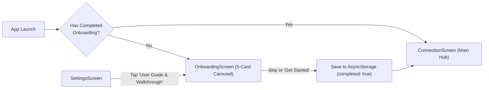

# kiMo — First-Launch Onboarding & User Experience Guide

> [!NOTE]
> This guide outlines the **5-card horizontal sliding carousel** displayed when a user launches **kiMo** for the first time, designed specifically for everyday users with zero technical or developer jargon.

---

## 1. Overview & Experience Goals

| Metric | Target / Implementation |
| :--- | :--- |
| **First Impression** | Clean, friendly, and approachable (Aurora Light Aesthetic) |
| **Reading Time** | Under 45 seconds total across all 5 cards |
| **Interaction** | Native horizontal swipe gestures (left / right) with pixel-perfect snap |
| **Controls** | Top slide counter (`1 of 5`), `Skip`, `< Back`, interactive dots, and `Next ›` |
| **Accessibility** | Re-accessible at any time from **Settings › User Guide & Walkthrough** |

---

## 2. Interactive Card Progression

````carousel

<!-- slide -->

<!-- slide -->

<!-- slide -->

<!-- slide -->

````

---

## 3. Card-by-Card Specification

### Card 1: Welcome to kiMo
- **Badge**: `✦ WELCOME TO KIMO`
- **Main Heading**: *Your Phone is Now Your Computer Mouse & Keyboard*
- **User Pitch**: *"No bulky mouse to carry around. Control your laptop or desktop with zero lag, anywhere you go."*
- **Key Highlights**:
  1. ⚡ **Lightning Fast (<1ms)**: Buttery-smooth cursor movement that responds instantly just like a physical mouse.
  2. 🖱️ **Intuitive Multi-Touch**: Smooth 1-finger navigation, tap-to-click, and effortless 2-finger web scrolling.
  3. 🛡️ **100% Private & Offline**: No internet, accounts, or cloud required. Works directly between phone and PC.
- **Bottom Prompt**: *"👉 Swipe left or tap Next to see how to connect"*

---

### Card 2: 3 Simple Ways to Connect
- **Badge**: `STEP 1 · CHOOSE HOW TO CONNECT`
- **Main Heading**: *Connect Wirelessly or with a Cable*
- **Description**: *"kiMo gives you three super-easy ways to connect. Pick whichever is most convenient:"*
- **Options Presented**:
  1. 🔌 **USB Cable (Recommended · <0.5ms Lag)**: Plug your phone into your PC with your regular charger cable. No Wi-Fi or data needed.
  2. 📶 **Wi-Fi Network**: Connect phone and laptop to the same Wi-Fi network. kiMo finds your computer automatically in 1 tap.
  3. 📡 **Phone Hotspot**: On a train, plane, or outdoors without a router? Turn on your phone's personal hotspot, connect your PC, and control it wire-free!

---

### Card 3: Simple & Intuitive Gestures
- **Badge**: `STEP 2 · HOW TO USE`
- **Main Heading**: *Master the Trackpad in Seconds*
- **Description**: *"The entire screen becomes your trackpad. Use the same natural gestures you already know:"*
- **Gesture Cheatsheet**:
  - 👆 **1-Finger Slide**: Steer the mouse cursor smoothly across your computer display.
  - 👆 **1-Finger Tap**: Standard Left-Click to open apps, select text, and click links.
  - ✌️ **2-Finger Slide**: Scroll up and down effortlessly on web pages, documents, and spreadsheets.
  - ✌️ **2-Finger Tap / 'Right' Button**: Open context menus and right-click options.
  - 🔒 **Drag Button**: Locks click down so you can easily move windows or highlight paragraphs without holding.

---

### Card 4: 1-Minute Computer Setup
- **Badge**: `STEP 3 · COMPUTER HELPER`
- **Main Heading**: *1-Minute Computer Setup*
- **Description**: *"Your computer just needs the lightweight kiMo companion running so it can receive your touches."*
- **Approachable User Copy**:
  - **No Complex Setup Needed**: If connecting via USB cable, simply tap **CONNECT USB** on the next screen and the connection is established automatically.
  - **Companion App Built-in**: The Ubuntu PC companion (30.6 MB) is packaged directly inside the mobile app:
    - 📥 **Save to Downloads**: Copies the file to your phone's Downloads folder to transfer via USB cable.
    - 📡 **Share via Bluetooth**: Sends the companion file directly to your laptop over Bluetooth.
  - **Collapsible Technical Details**: Non-technical users never see terminal commands unless they tap *"Show terminal install command (for Linux users)"*, which reveals `sudo apt install ./kimo_1.1.0_amd64.deb`.

---

### Card 5: Ready to Take Control!
- **Badge**: `✓ ALL SET · YOU'RE READY`
- **Main Heading**: *Ready to Take Control!*
- **Description**: *"Everything is set up. Choose how you would like to connect right now:"*
- **Quick Action Buttons**:
  - 🔌 **Connect with USB Cable** *(Fastest · 0.5ms speed · No Wi-Fi needed)* — Highlighted in bright Aurora Cyan.
  - 📶 **Connect Wirelessly (Wi-Fi)** *(Automatic scan on your local network)*.
  - 📡 **Use Phone Hotspot** *(Direct connection anywhere you go)*.
- **Persistent Access Tip**: *"💡 You can revisit this guide or adjust sensitivity at any time in Settings."*
- **Primary Action**: Bottom button transforms into **"Get Started ›"**.

---

## 4. UI Architecture & Implementation Details



### Key Technical Files
1. [`OnboardingScreen.tsx`](file:///home/etechsc/Personal/p/KeyMouse/mobile/src/screens/OnboardingScreen.tsx):
   - Implements horizontal paging via React Native `<ScrollView horizontal pagingEnabled>`.
   - Tracks current slide via `onMomentumScrollEnd` and updates live slide pills and pagination dots.
   - Contains direct download and Bluetooth share action handlers via [`InstallerService.ts`](file:///home/etechsc/Personal/p/KeyMouse/mobile/src/services/InstallerService.ts).
2. [`SettingsScreen.tsx`](file:///home/etechsc/Personal/p/KeyMouse/mobile/src/screens/SettingsScreen.tsx):
   - Provides a one-tap button to reopen the 5-card walkthrough at any time.
3. [`App.tsx`](file:///home/etechsc/Personal/p/KeyMouse/mobile/App.tsx):
   - Handles top-level routing between `onboarding`, `connect`, `touchpad`, `keyboard`, and `settings`.
